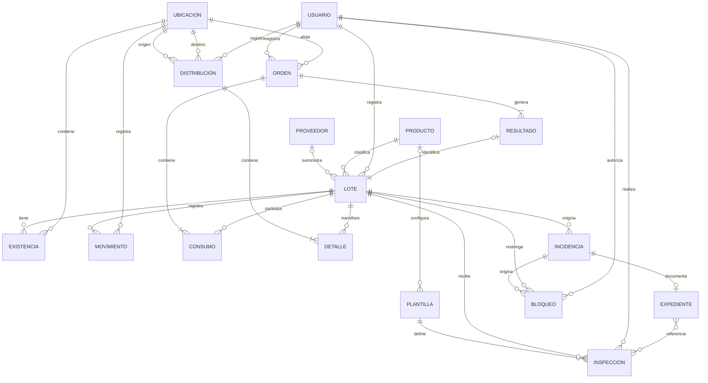

# DATA_MODEL.md — persistencia multimodelo v1.1

Especificación de implementación, no migraciones ejecutadas. 17 entidades de dominio (E-01..17), E-18 outbox, E-19 idempotencia: 16 tablas SQL + schema_migrations técnico, 3 colecciones MongoDB, 6 etiquetas y 7 relaciones Neo4j. No agregar entidades sin aprobación. PostgreSQL autoridad operativa, MongoDB documental, Neo4j proyección. Referencias entre motores por UUID canónico minúsculo; no FK distribuidas.

## 1. Conceptual

Relaciones de usuario adicionales: cada movimiento tiene actor; cada incidencia reportante y opcional cerrador; cada bloqueo opcional liberador. Movimiento puede referenciar orden o distribución según tipo. Plantilla general sin producto; expediente temporalmente ausente por sincronización. E-18 referencia polimórfica entidad_id/tipo_entidad, no FK a todas las tablas; E-19 actor FK. No tabla de padres/hijos: se deriva de consumo y resultado. Todas las salidas de una orden dependen potencialmente de todas sus entradas. Una distribución conserva identidad de lote y no crea dependencia.

## 2. PostgreSQL 16 — diccionario físico
DB tracechain, esquema public. Convención: todos los campos NN salvo sufijo `?`; `U` UUID, `V(n)` VARCHAR(n), `T` TEXT, `D` DATE, `TS` TIMESTAMPTZ, `Q` NUMERIC(18,3), `B` BOOLEAN, `I` INTEGER, `J` JSONB. Cada id U PK DEFAULT gen_random_uuid() (se puede proporcionar UUID para fixture controlado); created_at/updated_at TS DEFAULT now(), updated_at mantenido por servicio. FK restrictivas (ON DELETE RESTRICT, ON UPDATE RESTRICT); no borrado histórico por API. UQ incluye NN salvo indicado. Nombres y códigos trim no vacíos; códigos manuales según RN-112. Check cantidad >0 y saldos ≥0; prohibir NaN/Infinity y escala excedida antes de cast; UNIDAD entero mediante servicio. Q rango positivo máximo 999999999999999.999; comprobar overflow en agregaciones/actualizaciones, totales de consulta pueden superar Q y se serializan decimal exacto. Instantes UTC, fechas civiles America/Mexico_City; válido durante día de caducidad, caducado al siguiente. Tiempo servidor inyectable para pruebas. 3FN con redundancias controladas de saldo/historial y cantidad inicial/resultado.

| ID y tabla | Columnas y tipos | Restricciones |
|---|---|---|
| E-01 usuarios | id U; nombre V(150); correo V(254); password_hash T; rol V(30); activo B default true; created_at TS; updated_at TS | correo único normalizado lowercase; rol OPERADOR/ANALISTA_CALIDAD |
| E-02 proveedores | id U; codigo V(50); nombre V(150); contacto V(150)?; correo V(254)?; telefono V(25)?; direccion T?; activo B default true; created_at TS; updated_at TS | codigo UQ |
| E-03 productos | id U; codigo V(50); nombre V(150); descripcion T?; tipo V(25); unidad_medida V(15); activo B default true; created_at TS; updated_at TS | codigo UQ; tipo MATERIA_PRIMA/INTERMEDIO/TERMINADO; unidad KG/G/L/ML/UNIDAD; tipo/unidad inmutables con lotes |
| E-05 ubicaciones | id U; codigo V(50); nombre V(150); tipo V(30); direccion T?; activo B default true; created_at TS; updated_at TS | codigo UQ; ALMACEN/PLANTA_PRODUCCION/SUCURSAL; stock positivo impide desactivar |
| E-04 lotes | id U; codigo V(50); producto_id U FK productos; proveedor_id U? FK proveedores; codigo_lote_proveedor V(100)?; tipo_origen V(20); cantidad_inicial Q; fecha_origen TS; fecha_caducidad D?; registrado_por U FK usuarios; created_at TS | codigo UQ; cantidad >0; RECEPCION requiere proveedor, PRODUCCION proveedor y codigo_lote_proveedor nulos; caducidad >= fecha civil origen; resultado único para producido |
| E-06 existencias | id U; lote_id U FK lotes; ubicacion_id U FK ubicaciones; cantidad Q; updated_at TS | UQ(lote_id,ubicacion_id); cantidad ≥0; conservar filas a cero |
| E-07 movimientos | id U; lote_id U FK lotes; ubicacion_id U FK ubicaciones; tipo V(35); sentido V(10); cantidad Q; cantidad_anterior Q; cantidad_posterior Q; orden_produccion_id U? FK ordenes_produccion; distribucion_id U? FK distribuciones; usuario_id U FK usuarios; fecha_movimiento TS; created_at TS | inmutable; positivo y saldo coherente; referencias excluyentes según tipo |
| E-08 ordenes_produccion | id U; codigo V(50); nombre V(150); ubicacion_id U FK ubicaciones; fecha_produccion TS; observaciones T?; usuario_id U FK usuarios; created_at TS | codigo UQ; completada; ≥1 consumo y resultado |
| E-09 consumos_produccion | id U; orden_produccion_id U FK ordenes_produccion; lote_id U FK lotes; cantidad Q | >0; UQ(orden_produccion_id,lote_id) |
| E-10 resultados_produccion | id U; orden_produccion_id U FK ordenes_produccion; lote_id U FK lotes; cantidad Q | >0, igual a cantidad_inicial; lote_id UQ |
| E-11 distribuciones | id U; codigo V(50); ubicacion_origen_id U FK ubicaciones; ubicacion_destino_id U FK ubicaciones; fecha_distribucion TS; observaciones T?; usuario_id U FK usuarios; created_at TS | codigo UQ; origen distinto destino; completada |
| E-12 detalle_distribuciones | id U; distribucion_id U FK distribuciones; lote_id U FK lotes; cantidad Q | >0; UQ(distribucion_id,lote_id) |
| E-15 incidencias | id U; codigo V(50); lote_origen_id U FK lotes; titulo V(200); tipo V(30); severidad V(15); estado V(20) default ABIERTA; estado_expediente V(20) default PENDIENTE; reportado_por U FK usuarios; fecha_deteccion TS; fecha_cierre TS?; cerrado_por U? FK usuarios; resolucion T?; created_at TS; updated_at TS | codigo UQ; tipo CALIDAD/EMPAQUE/ALMACENAMIENTO/OTRO; severidad BAJA/MEDIA/ALTA; ABIERTA/EN_ANALISIS/CERRADA; PENDIENTE/SINCRONIZADO/ERROR; cierre exige fecha/actor/resolución, demás estados campos cierre nulos |
| E-17 bloqueos_lotes | id U; lote_id U FK lotes; incidencia_id U FK incidencias; motivo T; bloqueado_por U FK usuarios; fecha_bloqueo TS; activo B default true; desbloqueado_por U? FK usuarios; fecha_desbloqueo TS?; motivo_desbloqueo T? | UQ parcial(lote_id,incidencia_id) WHERE activo; activos sin campos liberación, inactivos todos obligatorios; fecha liberación >= bloqueo |
| E-18 eventos_sincronizacion | id U; secuencia BIGINT GENERATED ALWAYS AS IDENTITY UQ; tipo_evento V(60); entidad_id U; tipo_entidad V(40); motor_destino V(15); payload J; estado V(20) default PENDIENTE; intentos I default 0; ultimo_error T?; proximo_intento_at TS?; procesando_desde TS?; created_at TS; processed_at TS? | destino NEO4J/MONGODB; estado PENDIENTE/PROCESANDO/COMPLETADO/FALLIDO; intentos ≥0; payload objeto con payloadVersion; completado processed_at no nulo; tipos según API |
| E-19 solicitudes_idempotentes | id U; clave U; usuario_id U FK usuarios; operacion V(100); request_hash V(64); response_status SMALLINT; response_body J; created_at TS | UQ(usuario_id,operacion,clave); hash SHA-256 hex; guardar respuesta 2xx confirmada; sin purga automática MVP |

schema_migrations: version TEXT PK, checksum TEXT NN, applied_at TS NN; exclusivamente infraestructura. SQL numerado 001_catalogs, 002_inventory (crear lotes/existencias; FK movimientos a órdenes/distribuciones se añade después), 003_production, 004_distribution, 005_incidents, 006_integration, 007_views_indexes. Migraciones transaccionales y checksum, no editar aplicadas. Crear secuencias independientes para OP/DIST/INC; código prefijo + entero mínimo 6 dígitos, no reutilizar huecos. Restricciones cross-table complejas se garantizan dentro de servicios transaccionales; no CHECK que consulte otras tablas. No procedimientos almacenados obligatorios.

Movimiento: RECEPCION/ENTRADA (ambas referencias nulas), CONSUMO_PRODUCCION/SALIDA y RESULTADO_PRODUCCION/ENTRADA (orden obligatoria, distribución nula), DISTRIBUCION_SALIDA/SALIDA y DISTRIBUCION_ENTRADA/ENTRADA (distribución obligatoria, orden nula). CHECK aritmético posterior=anterior±cantidad, saldos no negativos, fecha efectiva de operación. Actores internos no se obtienen del body. No movimientos manuales.

### Índices adicionales (PK/UQ ya crean índice)
| Tabla | Campos |
|---|---|
| lotes | producto_id; proveedor_id; fecha_caducidad |
| existencias | (ubicacion_id,lote_id) |
| movimientos | (lote_id,fecha_movimiento DESC); orden_produccion_id; distribucion_id |
| ordenes_produccion | fecha_produccion DESC |
| consumos_produccion | (lote_id,orden_produccion_id) |
| resultados_produccion | orden_produccion_id |
| distribuciones | (ubicacion_destino_id,fecha_distribucion); (ubicacion_origen_id,fecha_distribucion) |
| detalle_distribuciones | lote_id |
| incidencias | (estado,fecha_deteccion DESC); lote_origen_id |
| bloqueos_lotes | lote_id WHERE activo; incidencia_id; UQ parcial indicado arriba |
| eventos_sincronizacion | (motor_destino,secuencia) WHERE estado <> 'COMPLETADO' |

### Vistas SQL
v_inventario: lote_id, producto_id, ubicacion_id, cantidad_fisica, cantidad_utilizable, unidad_medida, bloqueado, caducado; join existencias/lotes/productos/ubicaciones, EXISTS bloqueos activos. v_estado_lotes: por lote, total físico COALESCE sum, utilizable, cantidad bloqueos activos, caducado, agotado (total físico=0). v_dependencias_productivas: lote_padre_id, orden_produccion_id, lote_hijo_id, consumo_id, resultado_id; join consumos/resultados por orden. No materializar tabla de genealogía. Vistas fecha actual civil; para pruebas reloj inyectable mediante consultas equivalentes con fecha de referencia, no alterar datos por pasar tiempo.

### Transacciones y concurrencia
READ COMMITTED, locks explícitos en orden global: reserva idempotencia (lock transaccional por actor/operación/clave, consultar respuesta), catálogos necesarios orden por tabla/UUID (productos, proveedores, ubicaciones, consistente en toda operación), incidencia si aplica, lotes orden UUID, existencias orden lote/ubicación, finalmente lock global de asignación outbox y secuencia. Revalidar después de locks; operaciones de catálogo deben usar mismos locks (evitar carrera desactivar ubicación vs registrar stock; tipo/unidad vs nuevo lote). Nunca adquirir locks de negocio después de lock outbox. Orden/especificación de locks compartida por todos. No hold SQL durante I/O Mongo/Neo; verificar dependencias externas antes de transacción y revalidar estado SQL dentro. Referencias de inspecciones/genealogía inmutables. En cierre/actualización, lock incidencia, comprobar expediente sincronizado y versión leída; para actualizar, comparar expectedVersion y no pendiente; lectura externa antes del lock y revalidar estado/versión mediante última versión aplicada del outbox SQL (derivada de eventos completados, no columna adicional). ACK del evento actualiza estado expediente y evento en misma transacción.

T-01 recepción: validar actor/catálogos/cantidad/fecha/código; lote + existencia + movimiento entrada + outbox + respuesta idempotente; commit. T-02 producción: validar 1..50 insumos y 1..20 salidas, lock, verificar stock y bloqueo/caducidad/fecha, crear orden/consumos, descontar, crear lotes/resultados/existencias, movimientos, evento + respuesta, commit. T-03 distribución: validar y lock, detalle, descontar/incrementar stock (upsert destino con restricción), dos movimientos/ítem, evento y respuesta. T-04 incidencia: validar referencias externas si necesarias, crear SQL + evento de expediente + idempotencia; expediente puede estar pendiente. T-05 bloqueo/liberación: comprobar pertinencia, locks incidente/lotes, validar estado, insertar o liberar por ID; no cambia físico. T-06 expediente: lock incidente, comparar versión confirmada, encolar actualización, marcar pendiente; cierre solo con versión sincronizada, no evento obligatorio. Cualquier fallo previo al commit revierte todo. Las lecturas oficiales pueden continuar con secundarios caídos; no afirmar éxito de escritura documental si pendiente.

### Outbox (protocolo compartido)
Payload JSONB = {payloadVersion:1,payload:{...}} según API_CONTRACT. Secuencia asignada al final bajo lock exclusivo transaccional, no asumir que identity sola ordena commits. Consumidor por destino con advisory lock de sesión dedicado (conexión no devuelta a pool hasta liberar); escoger menor secuencia no COMPLETADO, sin SKIP LOCKED que salte dependencias. Marcar PROCESANDO e incrementar intentos en transacción corta; aplicar handler en destino con deadline 30s; confirmar COMPLETADO/processed_at y estado expediente si corresponde en otra transacción corta. Poll 2s; backoff 5,10,20,... max 300s; estado FALLIDO con próximo intento para transitorios, null para permanente que requiere intervención técnica; no descartar ni saltar. Al recuperar lock exclusivo, un PROCESANDO residual vuelve a pendiente/reintento; garantizar que llamada anterior terminó/canceló antes de iniciar otra si proceso sigue vivo. Reaplicar eventos con IDs estables; sin garantía exactamente una vez. Historial se conserva. SQL error sanitizado. No endpoint público para manipular cola. Si reconstruir Neo, detener consumidor en entorno mantenimiento, recrear proyección desde eventos completos en orden o datos canónicos equivalentes, verificar integridad, reanudar; no borrar autoridad SQL. Pruebas de caída después de commit destino antes de ACK.

## 3. MongoDB 8.0 — modelo documental
DB tracechain_quality, driver mongodb 6.x >=6.10, instancia única. _id String UUID v4, API id; referencias UUID string. BSON Date UTC, Int32 para enteros y versiones, Decimal128 finitos para decimales (API string). No duplicar autoridad SQL. Los campos opcionales que no tengan valor se pueden omitir en DB, API null; los nulos explícitos del esquema se indican. Validadores strict/error con $jsonSchema, additionalProperties:false en documentos y subdocumentos fijos (declarar _id); objeto parametros inspección permite claves dinámicas autorizadas por servicio. Limitar 30 parámetros, 30 hallazgos, 20 evidencias, 50 inspecciones por expediente, descripciones 5000, notas 3000, referencia 500; texto dinámico máximo 3000, selección máximo 150. UUID/enum/longitud/rango/required en validadores; validación dinámica de plantilla y referencias en NestJS. No GridFS/binarios.

| Colección | Campos BSON (obligatorios salvo ?) | Índices |
|---|---|---|
| E-14 plantillas_inspeccion | _id string; codigo string; nombre string; descripcion string?; producto_id string/null; version int ≥1; parametros array; activo bool; created_at date | _id; UQ(codigo,version); UQ(producto_id) parcial activo=true (incluye general null) |
| E-13 inspecciones_calidad | _id string; codigo string; lote_id string; producto_id string; plantilla_id string; plantilla_version int; inspector_id string; fecha_inspeccion date; parametros object; resultado enum; hallazgos array; observaciones string?; evidencias array; idempotency_key string; request_hash string; created_at date | _id; UQ(codigo); (lote_id,fecha_inspeccion DESC); (producto_id,resultado,fecha_inspeccion DESC); (resultado,fecha_inspeccion DESC); hallazgos.tipo multikey; UQ(inspector_id,idempotency_key) |
| E-16 expedientes_incidencias | _id string; incidencia_id string; descripcion string; inspecciones_ids array UUID distintos; hallazgos array; evidencias array; observaciones string?; resolucion_detallada string/null?; version int≥1; ultimo_evento_id string; created_at date; updated_at date | _id; UQ(incidencia_id); inspecciones_ids multikey |

Parámetro de plantilla: clave string regex ^[a-z][a-z0-9_]*$ max 64, etiqueta string max150, tipo_dato TEXTO/ENTERO/DECIMAL/BOOLEANO/SELECCION, unidad string/null, requerido bool, opciones array strings (solo selección no vacío y distintos), minimo/maximo Decimal128/null (solo numéricos; min<=max); ENTERO Int32 y límites enteros. Parámetros 1..30, claves únicas. Valor inspección: TEXTO string, ENTERO Int32, DECIMAL Decimal128, BOOLEANO bool, SELECCION string exacto. Opcionales ausentes, no null salvo esquema explícito; no coerción silenciosa. No conforme exige ≥1 hallazgo, decisión manual. Hallazgo {tipo enum IMPUREZAS/HUMEDAD/PESO/EMPAQUE/APARIENCIA/TEXTURA/TEMPERATURA/OTRO, parametro string/null, descripcion string, severidad BAJA/MEDIA/ALTA}; en inspección parametro existente en plantilla si no null, en expediente null (no plantilla propia). Evidencia {tipo IMAGEN/DOCUMENTO/REFERENCIA, referencia string, descripcion string?, fecha_registro date}, referencia no implica archivo accesible; no fetch automático. Fechas de evidencia servidor. Arrays pueden vacíos salvo no conformidad. Inspecciones inmutables; INS-UUID, índice inspector/clave; hash canónico API, replay primero tras auth, conflicto distinto hash; carrera insert duplicate key se resuelve leyendo ganador y comparando.

Plantillas: específica activa preferente, fallback general. Si ninguna, 503 TEMPLATE_UNAVAILABLE. Id identifica versión; contenido inmutable, cambiar activo solo migración controlada sin escrituras concurrentes (instancia única, no transacción multidoc requerida). Historial recupera id/version anterior. Inicialización: seis plantillas v1, todos parámetros requeridos, sin límites sanitarios; mínimos/máximos son de admisibilidad.

| Código / producto | Parámetros (clave:tipo/unidad/opciones o límites) |
|---|---|
| TPL-HARINA / PRD-001 | humedad:DECIMAL/%/0..100; color:SELECCION/BLANCO,CREMA,OTRO; impurezas:BOOLEANO; empaque:SELECCION/INTEGRO,DANADO |
| TPL-AZUCAR / PRD-002 | humedad:DECIMAL/%/0..100; color:SELECCION/BLANCO,CREMA,OTRO; grumos:BOOLEANO; impurezas:BOOLEANO |
| TPL-MASA / PRD-004 | temperatura:DECIMAL/°C; textura:SELECCION/SUAVE,FIRME,IRREGULAR; consistencia:SELECCION/HOMOGENEA,HETEROGENEA |
| TPL-PAN / PRD-006 | peso:DECIMAL/g/min 0; textura:SELECCION/SUAVE,FIRME,IRREGULAR; empaque:SELECCION/INTEGRO,DANADO |
| TPL-GALLETAS / PRD-007 | peso:DECIMAL/g/min 0 (peso paquete); piezas_danadas:ENTERO/unidades/min 0; textura:SELECCION/CRUJIENTE,BLANDA,IRREGULAR; empaque:SELECCION/INTEGRO,DANADO |
| TPL-GENERAL / null | apariencia:TEXTO; estado:SELECCION/NORMAL,IRREGULAR; anomalias:BOOLEANO |

Ejemplo inspección harina (representación API de valores BSON): parametros {"humedad":"16.5","color":"BLANCO","impurezas":true,"empaque":"INTEGRO"}; resultado NO_CONFORME; hallazgos [{"tipo":"IMPUREZAS","parametro":"impurezas","descripcion":"Material extraño (dato ficticio)","severidad":"ALTA"}]. Pan parametros {"peso":"450.5","textura":"SUAVE","empaque":"INTEGRO"}. No inferir conformidad automáticamente. Etiquetas visibles en español con acentos.

Expediente: solo handler escribe. Creación _id UUID generado en evento, version=1, ultimo_evento_id; upsert por incidencia_id, si ya existe verificar identidad/version/evento; no sobreescribir versiones posteriores. Actualización CAS por incidencia_id y version esperada, $set campos permitidos + ultimo_evento_id + updated_at + $inc version en misma escritura; replay si ultimo_evento_id coincide; versión mayor por evento anterior ya aplicado no sobreescribir, verificar historial SQL; inesperado conflicto permanente. Una actualización pendiente por incidencia y orden global Mongo garantizan que no llega una posterior antes de ACK. Fecha/IDs de evento estables. Estado oficial/cierre solo PG; no copia de estado en Mongo. Cierre no escribe Mongo, no reabrir. Consultar documentos con $lookup inspecciones solo de IDs referenciados. No modificar inspecciones al editar expediente. Si fuente no disponible, no aceptar referencia no verificada.

## 4. Neo4j 5.26 Community — modelo físico
DB neo4j. Cypher 5, neo4j-driver 6.x. UUID String. Fechas ZonedDateTime UTC. Cantidades INTEGER escaladas x1000 (`cantidad_milesimas`) exactas, convertir desde string con decimal.js/BigInt y neo4j Integer, no JS Number; Q individual cabe signed 64 bits, agregaciones oficiales SQL. No APOC/GDS obligatorios.

| Etiqueta | Propiedades requeridas (String salvo indicado) |
|---|---|
| Proveedor | id,codigo,nombre,activo Boolean |
| Producto | id,codigo,nombre,tipo,unidad_medida,activo Boolean |
| Lote | id,codigo,tipo_origen,fecha_origen ZonedDateTime |
| Proceso | id,codigo,nombre,fecha_produccion ZonedDateTime,ubicacion_id |
| Distribucion | id,codigo,fecha_distribucion ZonedDateTime |
| Ubicacion | id,codigo,nombre,tipo,activo Boolean |

| Origen | Relación | Destino | Propiedades/ID determinista |
|---|---|---|---|
| Proveedor | SUMINISTRA | Lote | id=SUMINISTRA:<lotUUID>, fecha_recepcion ZonedDateTime |
| Lote | CORRESPONDE_A | Producto | id=CORRESPONDE_A:<lotUUID> |
| Lote | UTILIZADO_EN | Proceso | id UUID consumo, cantidad_milesimas Integer, unidad String |
| Proceso | GENERA | Lote | id UUID resultado, cantidad_milesimas, unidad |
| Lote | INCLUIDO_EN | Distribucion | id UUID detalle, cantidad_milesimas, unidad |
| Distribucion | SALE_DE | Ubicacion | id=SALE_DE:<distributionUUID> |
| Distribucion | ENTREGADO_A | Ubicacion | id=ENTREGADO_A:<distributionUUID> |

Cada lote recibido un proveedor, producido uno proceso generador; todos un producto; proceso al menos un input/output; distribución al menos un lote, un origen y un destino distintos. Unicidad `CREATE CONSTRAINT lote_id_unique IF NOT EXISTS FOR (n:Lote) REQUIRE n.id IS UNIQUE` para cada etiqueta y `CREATE CONSTRAINT consumo_id_unique IF NOT EXISTS FOR ()-[r:UTILIZADO_EN]-() REQUIRE r.id IS UNIQUE` para cada tipo de relación. Índices por codigo de cada etiqueta; propiedades requeridas/forma cardinalidad mediante handler + pruebas (no Enterprise). Scripts 001_node_constraints, 002_relationship_constraints, 003_indexes; no almacenar stock, bloqueos, inspecciones, estado incidencia ni datos de contacto. MERGE nodos y relaciones con IDs, validar extremos, verificar conteo esperado antes de commit; no considerar MATCH vacío éxito. Todo evento en una transacción Neo. Actualizar catálogos incluso inactivos, preservar relaciones. No editar nodos desde UI.

Recorridos BFS por niveles con consultas Cypher de vecinos productivos, conjunto visitado, deduplicar y mínimo nivel, orden determinista por UUID. Un nivel son dos aristas. Hacia atrás invierte GENERA/UTILIZADO_EN. Proveedores por SUMINISTRA inversa de raíces recibidas; destinos por INCLUIDO_EN→ENTREGADO_A desde origen/descendientes; no avanzar por otras relaciones. Caminos dirigidos variable length con tipos productivos, validar alternancia, profundidad, límite y deadline. SHORTEST desempata lexicográfico de secuencia IDs de relaciones; ALL orden profundidad y secuencia IDs, recuperar hasta maxPaths+1 para detectar más. Evitar enumerar todas rutas para alcance. Comunes: intersección de antecedentes estrictos de todos. Genealogía unión de las dos direcciones, no convertir otros insumos de procesos descendientes en afectados. Subgrafo incluye aristas reales y extremos, cap 500 nodos/1500 edges (priorizar raíces y caminos completos por profundidad/UUID, si no caben omitir tramo completo y marcar truncamiento); nunca aristas colgantes. Análisis hasta 10000 lotes incluyendo raíces, 20 niveles max, 10 default, 10s deadline global; si excede o frontera no verificable, PARCIAL. Consultar cap+1 o frontera para distinguir exactamente límite de exceso. No persistir resultados. Comprobar outbox antes/después, marcas secuencia y pendientes; cambios concurrentes detectados parcial. Usar lecturas SQL agrupadas y transacciones de lectura coherentes donde posible; no prometer snapshot entre motores.

Ejemplos de consulta de referencia (no ejecutados):
```cypher
MATCH (o:Lote {id:$lotId})-[:UTILIZADO_EN]->(:Proceso)-[:GENERA]->(d:Lote)
RETURN DISTINCT d.id AS lotId ORDER BY lotId
```
```cypher
MATCH p=(o:Lote {id:$lotId})-[:UTILIZADO_EN|GENERA*2..40]->(d:Lote)
RETURN d.id AS lotId,min(length(p)/2) AS depth ORDER BY depth,lotId
```
Segunda es referencia experimental con literal profundidad máxima, acotar parámetro por allowlist al generar consulta o BFS parametrizado; no concatenar entrada sin validar. En runtime no enumerar caminos exponenciales para simple alcanzabilidad. SQL CTE recursiva sobre v_dependencias_productivas con profundidad acotada, deduplicar (lote,depth) y agrupar min(depth); atrás invierte padres/hijos. Pruebas QE equivalentes; usar límites idénticos.

## 5. Fixture canónico de regresión (ficticio)
UUID deterministas v4 de fixture: formato `00000000-0000-4000-8000-XXXXXXXXXXXX` con sufijo decimal 12 dígitos por categoría (usuarios 101/102, proveedores 201..203, productos 301..307, ubicaciones 401..404, lotes 501..509, órdenes 601..605, distribuciones 701..703, plantillas 801..806, inspecciones 901..904, incidencia 1001, expediente 1101; completar IDs de consumos/resultados/movimientos/eventos/bloqueos en rangos separados, sin colisiones). No usar IDs fijos en producción. Usuarios demo operador@example.com y analista@example.com; contraseña por entorno, hash Argon2id. Proveedores PROV-001 harina A y B; PROV-002 azúcar; PROV-003 mantequilla. Ubicaciones UB-001 planta principal PLANTA_PRODUCCION, SUC-01 Centro, SUC-02 Norte, SUC-03 Sur. Todos activos. Productos PRD-001 harina KG, PRD-002 azúcar KG, PRD-003 mantequilla KG (materias primas), PRD-004 masa KG, PRD-005 mezcla KG (intermedios), PRD-006 pan UNIDAD, PRD-007 galletas UNIDAD (terminados). Reloj fixture 2026-11-25T20:00:00Z; fechas efectivas ordenadas desde 15:00Z con incrementos de minutos; caducidad null en fixture base para evitar fallos dependientes del día, casos vencimiento separados. Todas recepciones/producciones en UB-001.

| Lote (orden de IDs 501..509) | Producto | Inicial | Final principal | Final sucursal |
|---|---|---:|---:|---|
| MP-001 | Harina A | 100 kg | 50 kg | — |
| MP-002 | Azúcar | 40 kg | 25 kg | — |
| MP-003 | Mantequilla | 20 kg | 18 kg | — |
| MP-004 | Harina B | 50 kg | 35 kg | — |
| LP-001 | Masa | 35 kg | 10 kg | — |
| LP-002 | Mezcla | 28 kg | 8 kg | — |
| LP-003 | Pan A | 100 ud | 60 ud | 40 Centro |
| LP-004 | Galletas | 80 ud | 50 ud | 30 Norte |
| LP-005 | Pan B | 60 ud | 40 ud | 20 Sur |

| Orden | Insumos | Salidas |
|---|---|---|
| OP-000001 | MP-001 30, MP-002 5, MP-003 2 kg | LP-001 35 kg |
| OP-000002 | MP-001 20, MP-002 10 kg | LP-002 28 kg |
| OP-000003 | LP-001 25 kg | LP-003 100 ud |
| OP-000004 | LP-002 20 kg | LP-004 80 ud |
| OP-000005 | MP-004 15 kg | LP-005 60 ud |

DIST-000001 LP-003 40 Centro, DIST-000002 LP-004 30 Norte, DIST-000003 LP-005 20 Sur. Las cuatro inspecciones: MP-001 no conforme (IMPUREZAS, ALTA, parametro impurezas, valores ejemplo harina); LP-003 no conforme (APARIENCIA, MEDIA, parametro null, peso "450.5", textura SUAVE, empaque INTEGRO); LP-004 no conforme (TEXTURA, MEDIA, parametro textura, peso "150", piezas_danadas 2, textura BLANDA, empaque INTEGRO); LP-005 conforme (peso "450", textura SUAVE, empaque INTEGRO, sin hallazgos). Incidencia INC-000001 raíz MP-001, tipo CALIDAD, severidad ALTA, EN_ANALISIS al terminar seed, expediente v1 con inspección raíz, sin bloqueos base; pruebas aplican bloqueos aparte (dashboard base 9 lotes/5 producciones/1 incidencia activa/0 bloqueados). Inspecciones 3/4 no conformes=75%, pan 1/2=50%, harina y galletas 100% cada uno, hallazgos IMPUREZAS/APARIENCIA/TEXTURA uno cada uno, alta 1 media 2. No criterios sanitarios reales.

Resultados: MP-001 directos LP-001/002, indirectos LP-003/004, impacto total 5 incluyendo origen; destinos Centro/Norte; antecedentes LP-003: LP-001,MP-001,MP-002,MP-003; LP-004: LP-002,MP-001,MP-002; comunes MP-001/MP-002. MP-004 solo LP-005/Sur; no ruta MP-001→LP-005. No propagar a co-insumos o proveedor compartido. Ruta MP-001→OP-000001→LP-001→OP-000003→LP-003 = 2. Existencia física total LP-003 100, LP-004 80, LP-005 60. Usable igual a físico antes de bloqueo. No sumar kg con unidades.

Seed funcional por servicios y outbox: esquema → usuarios/catálogos/plantillas → recepción/producción/distribución → drenar Neo → inspecciones/incidencia → drenar Mongo → iniciar análisis → validar expected-results.json. Permitir UUID fijados exclusivamente en harness/seed interno sin alterar DTO públicos. Conjunto oficial no se carga como tres bases independientes. Reinicio seed: usar DB de demo limpia autorizada o detectar estado y rechazar sin duplicar; no borrar datos reales. Benchmark separado con cargador masivo equivalente y semilla fija, registrar configuración.

### 5.1 Escenario ampliado de demostración (DEMO-150, v1.1)
**Propósito:** segunda semilla ficticia reproducible para probar RF-12, RF-16..30, RF-33..35 y QI-03/04 sin modificar el fixture canónico de §5, los esquemas ni el API. No es una ampliación del MVP ni un dataset real. Elegir el escenario de forma explícita al ejecutar el seed interno; utilizar un entorno dedicado de demo limpio y autorizado, separado de fixture canónico, tests de fallo y benchmark. No agregar selector de datos a la UI ni endpoint de generación.

| Entidad | Cantidad esperada al finalizar seed |
|---|---:|
| Usuarios | 2 (roles existentes) |
| Proveedores | 8 |
| Productos | 15 (5 materias primas, 4 intermedios, 6 terminados) |
| Ubicaciones | 6 |
| Lotes | 150 (30 recibidos + 120 producidos) |
| Órdenes de producción | 60 |
| Distribuciones | 40 |
| Plantillas | 6 v1 (las mismas de §3, fallback general) |
| Inspecciones | 80 (40 conformes, 40 no conformes) |
| Incidencias / expedientes | 10 / 10 |
| Bloqueos activos al iniciar demo | 0 |

**Plan determinista de generación.** Semilla de referencia 42 para datos auxiliares; el esqueleto topológico no es aleatorio. Grupos g=1..10; cada grupo tiene 3 raíces recibidas r1/r2/r3, 6 procesos y 12 salidas nuevas. Nombres lógicos `D01-r1`, `D01-a1`, etc. son alias del manifiesto, no necesariamente los códigos internos: generar códigos/UUID conforme a RN-112, reglas vigentes y formato por entidad. Usar UUID v4 deterministas exclusivos de fixture (p. ej. mismo prefijo de §5 con sufijos en rangos a partir de 200000 por entidad y contador global sin colisiones); no reutilizar UUID del canónico. Proveedores PROV-001..008, productos PRD-001..015 conservando los primeros siete de §5. Añadir PRD-008 sal KG y PRD-009 levadura KG (materias primas), PRD-010 prefermento KG y PRD-011 masa laminada KG (intermedios), PRD-012 bollo, PRD-013 pan integral, PRD-014 pan dulce, PRD-015 galleta de avena (terminados UNIDAD). Los cinco productos específicos originales mantienen su plantilla; los demás usan TPL-GENERAL si no tienen específica. No añadir plantillas para cumplir el conteo. Ubicaciones: planta UB-001 y cinco destinos activos (tres sucursales de §5 y dos ubicaciones adicionales válidas). Todos los catálogos activos.

Asignación reproducible: recorrer circularmente los catálogos ordenados por código de cada categoría; cada recepción toma el siguiente proveedor (8) y siguiente materia prima (5), cada salida intermedia toma siguiente intermedio (4), cada salida terminada siguiente terminado (6). Reiniciar contadores al comienzo de la generación, no por grupo. Así todos los catálogos se utilizan y se comparten entre grupos. Todas las recepciones y producciones ocurren en planta. Reloj de demo fijo, fechas UTC no futuras e incrementales (por ejemplo inicio 2026-11-24T00:00:00Z, +1 minuto por operación y reloj 2026-11-25T20:00:00Z); caducidad null. Ejecutar todas las recepciones y órdenes de cada grupo antes de distribuir; todas las distribuciones antes de abrir incidencias; sin bloqueos durante seed. No transferir ni consumir entre grupos. Cantidades enteras de ejemplo con representación API decimal de tres dígitos; no afirmar balance industrial de masa.

| Proceso de cada grupo | Entradas (5 kg por cada lote, salvo recepción previa) | Salidas nuevas |
|---|---|---|
| p1 | r1, r2 | a1, a2 (20 kg cada uno) |
| p2 | a1, r3 | b1, b2 (20 kg cada uno) |
| p3 | a2, r3 | c1, c2 (20 kg cada uno) |
| p4 | b1, c1 | d1, d2 (20 kg cada uno) |
| p5 | d1, b2 | e1 (20 kg), e2 (40 unidades) |
| p6 | e1, d2 | f1, f2 (40 unidades cada uno) |
Cada raíz r1/r2/r3 se recibe con 100 kg. Ejecutar p1..p6 en orden. Las dependencias reales son las aristas Lote→Proceso→Lote de §4, no aristas directas duplicadas. Las dos ramas p2/p3 convergen en p4; p5 y p6 añaden caminos de diferente longitud. Todos los resultados de una orden dependen de todos los insumos; no crear conexiones por proveedor, producto o destino compartido. Los 10 componentes independientes son de la proyección productiva (el grafo completo puede estar conectado por catálogos y ubicaciones).

Cuatro distribuciones por grupo, cada una con un detalle. Sea B,C,D,E cuatro destinos distintos elegidos rotando la lista de cinco destinos (para g, empezar en índice (g−1) mod 5; tomar los cuatro siguientes consecutivos con retorno circular). Transferir f1 12 unidades planta→B; f1 4 unidades B→C; f2 10 unidades planta→D; e2 3 unidades planta→E, en ese orden. Se conservan UUID de lotes. No crear lotes nuevos por transferencia. Stock final f1 = 28 planta + 8 B + 4 C = 40; 16 unidades transferidas históricamente no significan 16 unidades distintas fuera de planta. f2 = 30 planta + 10 D; e2 = 37 planta + 3 E.

**Calidad y expedientes.** Una inspección de cada uno de r1, a1, b2, c2, d1, e2, f1, f2 por grupo. r1, b2, c2 y f1 NO_CONFORME, las otras cuatro CONFORME. Para todos los no conformes registrar un único hallazgo APARIENCIA, parametro null, severidad MEDIA y descripción ficticia; los conformes sin hallazgos. Completar todos los parámetros obligatorios con valores admitidos por su plantilla real (incluidos tipos BSON/representación API, sin inventar campos). La decisión se registra como analista, no cálculo automático. Total 40 hallazgos APARIENCIA/MEDIA; 50% no conformidad global. No añadir filtro por tipo de hallazgo al API: usar filtros existentes, agregaciones y detalle/selección de no conformes. Una incidencia por grupo con origen r1, CALIDAD, MEDIA, expediente con inspección de r1 y referencias de b2/c2 si pertinentes; al finalizar EN_ANALISIS y expediente SINCRONIZADO, sin bloqueos. El estado oficial queda en SQL. No inferir causa ni contaminación real.

**Oráculo esperado (por grupo, especialmente D01).** Guardar alias→UUID, parámetros, topología y resultados en `tests/fixtures/demo/ampliada/manifest.json` y `expected-results.json`, generados desde plan declarativo independiente de consultas bajo prueba; verificar conjuntos exactos, no solo conteos. Se espera:
- r1 descendientes estrictos: a1,a2 (nivel 1); b1,b2,c1,c2 (nivel 2); d1,d2,e1,e2 (nivel 3); f1,f2 (nivel 4). Impacto 13 lotes incluyendo r1; 12 descendientes únicos. Los niveles son mínimos, aunque hay caminos de 5 transformaciones a f1/f2. r2/r3 son co-insumos, no descendientes. No incluir lotes de otros grupos.
- Antecedentes estrictos comunes de b2 y c2: exactamente r1,r2,r3. Para b2: r1,r2,r3,a1; para c2: r1,r2,r3,a2. Proveedores de origen derivables de sus recepciones. No afirmar que alguno sea la causa.
- r1→d1 tiene exactamente dos rutas productivas de 3 transformaciones, vía a1/b1 y a2/c1; camino mínimo de 3. r1→f1 tiene mínimo 4 y rutas de hasta 5; verificar varias rutas sin confundir cantidad de rutas con lotes. No existe ruta de D01-r1 a D02-f1 pese a compartir catálogos/destinos.
- Destinos históricos del impacto r1: B,C,D,E. f1, f2 y e2 tienen las cantidades finales indicadas, no duplicar por rutas o transferencias. El origen conserva 95 kg; no sumar unidades con kg. La inspección y expediente se cruzan por UUID con datos SQL y Neo; 10 expedientes y 80 inspecciones, todos con referencias válidas.
- Grafo proyectado: 279 nodos (8 proveedores + 15 productos + 150 lotes + 60 procesos + 40 distribuciones + 6 ubicaciones); 540 relaciones (30 SUMINISTRA +150 CORRESPONDE_A +120 UTILIZADO_EN +120 GENERA +40 INCLUIDO_EN +40 SALE_DE +40 ENTREGADO_A). Contar por tipo, no contar inspecciones/incidencias como nodos. Dashboard: 150 lotes / 60 producciones / 10 incidencias activas / 0 lotes bloqueados. Con profundidad 1 y frontera adicional, resultado PARCIAL, no ausencia de dependencias.

**Carga y evidencia.** Reutilizar seed funcional por servicios y outbox según §5, en perfil interno explícito; no escribir tres DB independientemente ni desactivar validaciones. Drenar ambas proyecciones, validar stock no negativo, cantidades, referencias, conteos por tipo, estados y ausencia de pendientes/fallos antes de pruebas normales. Repetición: entorno aislado nuevo o rechazo de duplicados sin mutaciones parciales no autorizadas; nunca borrar datos normales. Registrar semilla, alias/UUID, reloj, configuración, conteos, comandos y salida. Pruebas DA-01..08 en REQUIREMENTS; ejecutar en entorno separado/restaurado para mutaciones y fallos. No mezclar este escenario con QE ni usarlo como prueba de rendimiento a 10000 lotes. No hay semilla implementada ni evidencia de ejecución en este documento.

## 6. Catálogo funcional y experimental
| ID | Consulta / entrada | Salida y uso |
|---|---|---|
| QP-01 | proveedores search/active | lista V03 |
| QP-02 | productos search/type/active | lista V04 |
| QP-03 | ubicaciones search/type/active | lista V05 |
| QP-04 | lotes search/productId/supplierId/expired | lista V06 |
| QP-05 | lote id | detalle V07 |
| QP-06 | inventario lot/product/location/blocked/expired | saldos físicos/utilizables V06/07/13 |
| QP-07 | movimientos lot/location/type/date | saldo anterior/posterior V07 |
| QP-08 | producción search/location/date | listado V08 |
| QP-09 | producción id | inputs/outputs V08 |
| QP-10 | distribución origen/destino/lote/date | historial V09/13 |
| QP-11 | distribución id | detalles V09 |
| QP-12 | incidencia status/severity/lot/date | lista V11 |
| QP-13 | incidencia id | estado oficial V12/13 |
| QP-14 | bloqueos lot/incident/active | restricciones V07/12/13 |
| QP-15 | dashboard | cuatro indicadores y actividad V02 |
| QP-16 | estado outbox por motor | pendientes/fallidos/última confirmación |
| QM-01 | producto id | plantilla activa específica/general V10 |
| QM-02 | lote/date | historial inspecciones V07 |
| QM-03 | resultado/lote/producto/date | lista inspecciones V10 |
| QM-04 | producto/date | evaluaciones V10 |
| QM-05 | producto/date | conteo conforme/no conforme V10 |
| QM-06 | producto/date | tasa por producto, null sin inspecciones V10 |
| QM-07 | producto/date/limit | unwind hallazgos, group tipo V10 |
| QM-08 | producto/date | unwind/group severidad V10 |
| QM-09 | incidencia id | expediente y referencias/lookup V12 |
| QM-10 | UUID[] lotes | resumen de calidad V13 (consultas por lotes en batch) |
| QG-01 | lote id | directos V14 |
| QG-02 | lote/profundidad | descendientes mínimo nivel V14 |
| QG-03 | lote | antecedentes directos V14 |
| QG-04 | lote/profundidad | antecedentes V14 |
| QG-05 | 2..5 lotes/profundidad | comunes V14, solo A |
| QG-06 | source/target/depth | camino corto V14 |
| QG-07 | source/target/depth/maxPaths | rutas V14 |
| QG-08 | lote/depth | proveedores origen V14 |
| QG-09 | lote/dirección/depth | procesos V14 |
| QG-10 | lotIds | destinos históricos V13/14 |
| QG-11 | lote/depth | origen + descendientes + destinos V13 |
| QG-12 | resultado recorrido | nodos/aristas acotados V13/14 |
| QI-01 | lote id | detalle integrado tres motores V07 |
| QI-02 | incidencia id | SQL+Mongo V12 |
| QI-03 | incidencia id/depth | impacto tres motores V13 |
| QI-04 | lotes no conformes seleccionados | comunes Mongo+Neo, V10→14 |
| QI-05 | consulta grafo | enriquecimiento SQL+Neo V14 |
| QI-06 | sistema | disponibilidad/consistencia V02 |

Consultas auxiliares por ID (inspección/plantilla/catálogos) no cuentan como entradas nuevas del catálogo. Parámetros, respuestas, roles y filtros exactos en API_CONTRACT. QM-05/06 incluyen productos sin inspecciones con cero conteo y porcentaje null; nombres desde PG; QM-07/08 cuentan hallazgos no documentos. C-14 devuelve lotes con alguna inspección no conforme, no inferir estado vigente definitivo. QI-04 selecciona IDs en UI y reutiliza common-origins, no endpoint adicional; validar lotes en servidor, modalidad común no exige que todos sean no conformes. QI-03 usa PG para cantidades actuales y destinos históricos; evita multiplicar cantidades por múltiples caminos; agrupar por lote/producto/ubicación/unidad, no sumas incompatibles. Resultados acotados y detalles bajo demanda.

| QE | Comparación SQL vs Cypher |
|---|---|
| QE-01 | descendientes multinivel |
| QE-02 | antecedentes multinivel |
| QE-03 | intersección antecedentes comunes |
| QE-04 | distancia productiva mínima |
| QE-05 | impacto potencial y destinos históricos |

Método en PROJECT. SQL CTE recursivas y Cypher directo para mediciones driver/motor; BFS aplicación se mide aparte. Conjuntos equivalentes, no comparar consultas con límites o materialización distintos. Scripts reproducibles en database/{relational,document,graph}/queries y tests/benchmark. No resultados inventados.

## 7. Matriz de 38 necesidades de información (IDs conservados)
| ID | Pregunta | Motor principal | Consulta |
|---|---|---|---|
| C-01 | ¿Qué proveedores están registrados? | PG | QP-01 |
| C-02 | ¿Qué materias primas y productos maneja la empresa? | PG | QP-02 |
| C-03 | ¿Qué lotes se recibieron de un proveedor? | PG | QP-04 |
| C-04 | ¿Qué cantidad disponible existe de un lote? | PG | QP-06 |
| C-05 | ¿En qué ubicaciones se encuentra un lote? | PG | QP-06 |
| C-06 | ¿Qué movimientos tiene un lote? | PG | QP-07 |
| C-07 | ¿Qué cantidades se utilizaron en una producción? | PG | QP-09 |
| C-08 | ¿Qué lotes generó una orden? | PG | QP-09 |
| C-09 | ¿Qué cantidades fueron distribuidas y a dónde? | PG | QP-10/11 |
| C-10 | ¿Qué lotes están bloqueados y por qué? | PG | QP-14 |
| C-11 | ¿Qué inspecciones se realizaron sobre un lote? | Mongo | QM-02 |
| C-12 | ¿Qué parámetros se evaluaron? | Mongo | QM-02 |
| C-13 | ¿Qué resultados y hallazgos se registraron? | Mongo | QM-02 |
| C-14 | ¿Qué lotes presentan inspecciones no conformes? | Mongo | QM-03 |
| C-15 | ¿Qué hallazgos son más frecuentes? | Mongo | QM-07 |
| C-16 | ¿Qué observaciones y evidencias tiene la incidencia? | Mongo | QM-09 |
| C-17 | ¿Cuántas inspecciones conformes/no conformes por producto? | Mongo | QM-05/06 |
| C-18 | ¿Cuál es el historial de calidad de un lote? | Mongo | QM-02 |
| C-19 | ¿De qué materias primas proviene un producto terminado? | Neo4j | QG-04 |
| C-20 | ¿Qué productos se fabricaron directamente con un lote? | Neo4j | QG-01 |
| C-21 | ¿Qué productos derivaron indirectamente? | Neo4j | QG-02 |
| C-22 | ¿Qué procesos intervinieron en la fabricación? | Neo4j | QG-09 |
| C-23 | ¿Qué proveedores participaron indirectamente? | Neo4j | QG-08 |
| C-24 | ¿Qué lotes de materia prima comparten dos o más productos? | Neo4j | QG-05 |
| C-25 | ¿Qué lotes intermedios comparten productos terminados? | Neo4j | QG-05 |
| C-26 | ¿Existe una ruta dirigida entre dos lotes? | Neo4j | QG-06 |
| C-27 | ¿Cuáles son sus caminos de procedencia? | Neo4j | QG-07 |
| C-28 | ¿Cuántos niveles de transformación los separan? | Neo4j | QG-06 |
| C-29 | ¿A qué establecimientos se distribuyeron derivados? | Neo4j | QG-02/10 |
| C-30 | ¿Cuál es la genealogía completa de un lote? | Neo4j | QG-02/04/12 |
| C-31 | ¿Qué lotes podrían estar afectados por una incidencia? | PG + Neo4j | QI-03 |
| C-32 | ¿Qué existencias permanecen disponibles de los lotes afectados potencialmente? | PG + Neo4j | QI-03 |
| C-33 | ¿Qué destinos los recibieron y en qué cantidades? | PG + Neo4j | QI-03 |
| C-34 | ¿Qué inspecciones tienen los lotes potencialmente afectados? | Neo4j + Mongo | QI-03/QM-10 |
| C-35 | ¿Qué antecedentes comparten lotes con inspecciones no conformes? | Mongo + Neo4j | QI-04 |
| C-36 | ¿Cuál es el impacto potencial considerando dependencias, existencias, destinos y evidencias? | PG + Mongo + Neo4j | QI-03 |
| C-37 | ¿Cuál es el expediente integrado de un lote? | PG + Mongo + Neo4j | QI-01 |
| C-38 | ¿El análisis utiliza información sincronizada? | PG + Neo4j | QI-06 |
