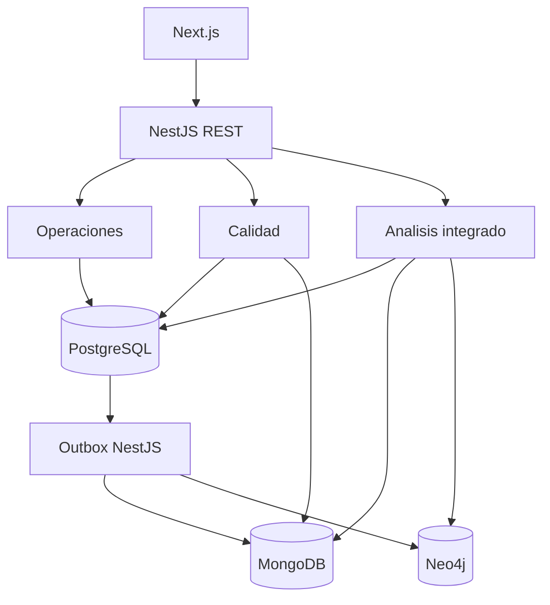

# TraceChain — especificación maestra v1.1

**Estado:** línea base de planificación para implementación; no representa software construido ni pruebas ejecutadas. Fecha de consolidación: 2026-11-25. Revisión v1.1: refuerzo analítico, demostración ampliada y aceptación; sin ampliación funcional.

**Proyecto:** TraceChain: análisis de trazabilidad y propagación de incidencias en redes de producción alimentaria.
**Institución:** Universidad Politécnica de Chiapas. **Docente:** Horacio Irán Solís Cisneros. **Equipo:** Cesar Yair Toledo Villarreal, Edwar Daniel González Hernández, Andrés Eduardo González Ruiz (verificar ortografía oficial y asignación nominal de I-1/I-3 antes de entrega académica; I-2 es el rol asumido por quien solicitó esta documentación).

## 1. Propósito y justificación
Una empresa panificadora ficticia transforma lotes de materia prima en lotes intermedios y terminados y los distribuye entre ubicaciones. Investigar la procedencia y alcance de un problema de calidad se dificulta cuando existen múltiples transformaciones, ramificaciones y convergencias. TraceChain registra las operaciones, reconstruye dependencias e integra información de calidad e inventario. Es apoyo académico a la investigación: dependencia potencial no demuestra contaminación, causa ni aptitud sanitaria.

Objetivo general: desarrollar una aplicación web multimodelo que permita registrar y analizar la genealogía de lotes y el impacto potencial de incidencias. Objetivos específicos: (1) preservar integridad de stock con transacciones SQL; (2) registrar inspecciones heterogéneas con plantillas versionadas y agregaciones documentales; (3) resolver recorridos dirigidos de profundidad variable, antecedentes comunes y caminos en Neo4j; (4) integrar las tres fuentes y reportar incertidumbre y fallos; (5) evaluar consultas SQL recursivas y Cypher con resultados equivalentes y mediciones reproducibles.

### 1.1 Prioridad científica y justificación del grafo
La pregunta central es cómo investigar dependencias de profundidad variable en una red de lotes con transformaciones sucesivas, ramificaciones, convergencias y caminos alternativos, no cómo administrar una panificadora. La gestión operativa alimenta la red; la visualización por sí sola no justifica Neo4j. Se priorizan RF-24..30 y la integración con RF-16..23 y RF-33..35. Un tipo de nodo puede tener miles de instancias. No se agregan etiquetas o aristas artificiales para aumentar tamaño. PostgreSQL también admite CTE recursivas: demostrar diferencias de expresividad, complejidad y rendimiento mediante evidencia, no afirmar que el problema sea imposible en SQL ni que Neo4j sea siempre superior.

Flujo de investigación prioritario (QI-04 y QI-03): el analista consulta inspecciones no conformes y sus hallazgos en MongoDB, selecciona de dos a cinco lotes distintos, investiga antecedentes comunes en Neo4j, selecciona un origen candidato con criterio humano y abre/consulta una incidencia; analiza descendientes y rutas; cruza existencias y destinos en PostgreSQL y calidad en MongoDB; registra observaciones y resolución en expediente, y decide bloqueos manuales justificados si corresponde. Un origen común es una hipótesis, no una causa comprobada. Se utilizan las vistas V-10, V-11/12, V-13 y V-14 y los endpoints existentes, sin nuevo algoritmo de correlación automática, colecciones, pantallas ni contratos.

## 2. Alcance y roles
Una empresa, varias ubicaciones; dos cuentas/roles precargados (pueden existir varias cuentas por rol). OPERADOR gestiona catálogos y registra recepciones, producción y distribución. ANALISTA_CALIDAD registra inspecciones, incidencias, actualiza expedientes, inicia/cierra investigaciones y aplica/retira bloqueos. Ambos consultan catálogos, operaciones, inventario, inspecciones, indicadores, incidencias, impacto, trazabilidad adelante/atrás/genealogía/caminos y estado del sistema. Orígenes comunes solo analista. Autorización efectiva en backend.

Flujo operativo: catálogos → recepción de materia prima → producción con lotes existentes y nuevas salidas → transformaciones sucesivas → transferencia completada entre ubicaciones. Cada operación proyecta relaciones automáticamente. Flujo calidad: lote → plantilla específica o general → parámetros → resultado manual y hallazgos → incidencia opcional → investigación → impacto → bloqueo manual justificado opcional → expediente actualizado → resolución y cierre. Cierre no libera bloqueos. No se requiere inspección previa para abrir incidencia.

Exclusiones: multiempresa, registro público, administración de usuarios, recuperación de contraseña, ventas, facturación, pagos, compras, costos, recetas, planificación industrial, transportistas, tránsito/confirmación posterior, ERP, IoT, blockchain, IA predictiva, aplicación móvil, notificaciones, editor de plantillas, carga binaria/PDF obligatorio, eliminación o corrección/anulación retroactiva de operaciones, disposición de stock y bloqueo automático. No incorporar extensiones sin acuerdo. Stock caducado/bloqueado permanece físico; sin disposición en MVP puede impedir desactivar una ubicación.

## 3. Vistas y experiencia
| ID | Ruta | Contenido/acción principal | Dueño |
|---|---|---|---|
| V-01 | /login | Credenciales, errores, sesión | I-1 |
| V-02 | /dashboard | Conteos de lotes, producciones, incidencias no cerradas y lotes con bloqueo activo; actividad reciente | I-3 UI / I-1 API |
| V-03 | /suppliers | Lista, filtros, alta, edición, activar/desactivar | I-1 |
| V-04 | /products | Catálogo, tipo, unidad, edición restringida | I-1 |
| V-05 | /locations | Ubicaciones y estado | I-1 |
| V-06 | /inventory | Lotes, cantidades por ubicación, recepción y filtros | I-1 |
| V-07 | /inventory/:id | Lote, stock, historial, calidad, genealogía, incidencias/bloqueos | I-1 coordina; I-2/I-3 secciones |
| V-08 | /production | Órdenes, detalle, formulario de insumos/salidas | I-1 |
| V-09 | /distribution | Transferencias, detalle y registro | I-1 |
| V-10 | /inspections | Listado, formulario dinámico, detalle, estadísticas, selección de lotes no conformes | I-2 |
| V-11 | /incidents | Listado, filtros, registro | I-2 |
| V-12 | /incidents/:id | Expediente, transiciones, bloqueos, resolución | I-2 |
| V-13 | /incidents/:id/impact | Resumen, lotes, stock, destinos, calidad y grafo | I-3 |
| V-14 | /traceability | Cuatro modalidades (adelante, atrás, comunes, caminos); genealogía combinada como acción adicional | I-3 |

Menú General (Dashboard), Operaciones (seis módulos), Calidad (Inspecciones/Incidencias), Análisis (Trazabilidad). Formularios y detalles secundarios en modales/paneles; no nuevas vistas obligatorias. Interfaces en español, listas paginadas, confirmación antes de mutaciones irreversibles, estados carga/vacío/error/parcial, no optimismo en stock, teclado/foco/contraste/alternativa textual al grafo. I-3 coordina identidad visual; referencia inicial fondo #F8FAFC, superficie #FFFFFF, texto #0F172A, primario #2563EB, éxito #15803D, aviso #B45309, error #DC2626, grafo #7C3AED. Paleta no certificada; identidad gráfica aún por diseñar, no impide implementar funcionalidad. Componentes compartidos AppSidebar, AppHeader, PageHeader, DataTable, SearchInput, FilterPanel, StatusBadge, ConfirmDialog, FormDrawer, EmptyState, ErrorState, LoadingState, SyncStatus, GraphViewer, QuantityDisplay.

## 4. Arquitectura
Monolito modular NestJS REST + Next.js App Router; navegador solo HTTP JSON. PostgreSQL autoridad operativa (incluye estado de incidencias y bloqueos); MongoDB autoridad documental (plantillas, inspecciones, expedientes); Neo4j proyección reconstruible de genealogía. UUID compartidos; no FK distribuidas. Outbox persistente SQL y dos consumidores lógicos (uno por destino) dentro de NestJS. Entrega al menos una vez, efectos idempotentes; no transacción distribuida. Si PG cae no hay autenticación ni operaciones protegidas; si Mongo cae operaciones SQL siguen, inspecciones no se guardan, incidencia sin inspecciones puede quedar pendiente; si Neo cae operaciones SQL siguen, análisis de grafos no disponible. Ver BUSINESS_RULES y API_CONTRACT.



## 5. Stack y configuración
| Tecnología | Familia aprobada |
|---|---|
| Node.js / npm / TypeScript | 22 LTS / 10.x / 5.9 |
| NestJS | 11.x |
| Next.js / React / Tailwind | 16.x / 19.x / 4.x |
| PostgreSQL / MongoDB / Neo4j | 16.x / 8.0.x / 5.26.x Community |
| Infraestructura | Docker Compose v2, Git/GitHub, npm Workspaces |
| Backend | @nestjs/config, @nestjs/jwt, @nestjs/swagger, @nestjs/throttler, @nestjs/schedule, class-validator, class-transformer, pg, mongodb 6.x >=6.10, neo4j-driver 6.x, argon2, decimal.js, joi, jest, supertest |
| Frontend | shadcn/ui, lucide-react, TanStack Query/Table, React Hook Form, Zod, Cytoscape.js, Recharts, Vitest, Testing Library, Playwright, fetch centralizado |
| Calidad | ESLint, Prettier, TypeScript strict |

No ORM (Prisma/TypeORM/Mongoose), no Redux/Zustand, Axios, microservicios, brokers, GDS/APOC obligatorios, Nx/Turborepo. Fijar parches compatibles y seguros al bootstrap mediante lockfile e imágenes exactas; verificar instalación/compilación, no asumir que ya se probó. Contratos TypeScript puros en packages/contracts, compilados antes de apps; no importar frameworks/drivers. DTO runtime en backend, validación formularios Zod. React Context sesión en memoria; TanStack Query para servidor; filtros URL; estado local para controles y grafo; localStorage solo preferencias no sensibles. Limpiar caché al salir; invalidar consultas tras mutaciones.

Docker servicios frontend:3000, backend:3001, postgres:5432, mongodb:27017, neo4j:7687 (Browser 7474); volúmenes postgres_data/mongodb_data/neo4j_data. Desarrollo: DB en Docker y apps npm; demo: cinco servicios en Compose. Puertos DB solo loopback local; red privada en despliegue público. HTTPS fuera de local. API pública de navegador debe usar URL alcanzable desde navegador, no hostname interno Docker. CORS origen explícito. Salud y errores sin secretos. Persistencia independiente de reinicios.

Variables requeridas: NODE_ENV, PORT=3001, FRONTEND_URL, NEXT_PUBLIC_API_URL (base con /api/v1), DATABASE_URL, MONGODB_URI, MONGODB_DATABASE=tracechain_quality, NEO4J_URI, NEO4J_USER, NEO4J_PASSWORD, NEO4J_DATABASE=neo4j, JWT_SECRET, JWT_EXPIRES_IN=8h, BUSINESS_TIMEZONE=America/Mexico_City, OUTBOX_ENABLED, OUTBOX_POLL_INTERVAL_MS=2000, OUTBOX_MAX_RETRY_DELAY_MS=300000, GRAPH_DEFAULT_DEPTH=10, GRAPH_MAX_DEPTH=20, GRAPH_MAX_RESULTS=10000, GRAPH_TIMEOUT_MS=10000, SWAGGER_ENABLED. Credenciales de inicialización de contenedores privadas (POSTGRES_USER/PASSWORD/DB, MONGO_INITDB_ROOT_USERNAME/PASSWORD, NEO4J_AUTH), sin valores reales en Git. Config inválida falla explícitamente; indisponibilidad de secundarios no impide modo degradado. Pruebas en instancias/volúmenes separados.

## 6. Estructura canónica y comandos
```
TraceChain/
  PROJECT.md AGENTS.md REQUIREMENTS.md BUSINESS_RULES.md DATA_MODEL.md API_CONTRACT.md PROGRESS.md
  README.md package.json package-lock.json .nvmrc .env.example .gitignore .editorconfig docker-compose.yml
  .github/workflows/ci.yml
  docs/{propuesta.md,arquitectura.md,decisiones-tecnologicas.md,modelos/,api/,pruebas/}
  database/relational/{schema,data,queries,tests}/
  database/document/{validators,data,queries,tests}/
  database/graph/{schema,data,queries,tests}/
  packages/contracts/{src/,package.json,tsconfig.json}
  backend/{src/,test/,package.json,Dockerfile}
  frontend/{src/,public/,package.json,Dockerfile}
  scripts/
  tests/{fixtures/demo/,integration/,e2e/,benchmark/}
```
Backend src: main.ts, app.module.ts, config/{env.validation.ts,app.config.ts,database.config.ts}, common/{decorators,guards,filters,interceptors,errors,pagination,validators,utils}, database/{postgres,mongodb,neo4j}, modules/{auth,users,suppliers,products,locations,lots,inventory,production,distribution,inspection-templates,inspections,quality,incidents,lot-blocks,traceability,impact,dashboard,system}, integration/{outbox,event-contracts,handlers/mongodb,handlers/neo4j,read-models}. Módulos controller/service/repository/mapper/dto/types/tests según necesidad. SQL de incidencias/bloqueos en database/postgres/repositories; servicios funcionales en modules. Controlador impact es único dueño de ruta de impacto. Capas: controller → service → repository → driver. Contexto transaccional explícito compartido (mismo PoolClient). Orquestadores consumen interfaces, no repositorios ajenos; evitar ciclos y forwardRef habitual. Firmas en API_CONTRACT.

Frontend src: app/layout.tsx, globals.css, app/(auth)/login/page.tsx, app/(dashboard)/layout.tsx y rutas V-02..14, components/{ui,layout,shared,feedback}, features/{auth,dashboard,suppliers,products,locations,inventory,production,distribution,inspections,incidents,traceability}, lib/{api,query-client,permissions,formatters,utils}, hooks, providers, types. Cada feature: components, hooks, services, schemas, utils según necesidad. GraphViewer compartido por impacto/explorador; cliente solamente, liberar instancia al desmontar. Ocultar procesos puede mostrar conexiones resumidas etiquetadas como virtuales, nunca como aristas reales.

Scripts raíz previstos: npm ci; npm run dev, dev:backend, dev:frontend, db:up, db:migrate, db:seed, lint, typecheck, test, test:integration, test:e2e, benchmark, build. Aún no existen por esta documentación. README documentará ejecución, requisitos, credenciales de demo vía entorno y limpieza segura. Migraciones SQL versionadas con checksum y tabla schema_migrations (infraestructura, fuera de 16 tablas); Mongo/Neo scripts repetibles. No ejecutar borrados sobre DB normal en pruebas.

## 7. Responsabilidades e hitos
I-1 PostgreSQL/operaciones/infraestructura: autenticación, catálogos, inventario, producción, distribución, repositorios SQL incidentes/bloqueos, dashboard API, outbox y benchmark SQL. I-2 MongoDB/calidad/documentación: validadores, plantillas, inspecciones, agregaciones, expedientes, servicios/controladores incidentes/bloqueos, handlers Mongo y UI calidad. I-3 Neo4j/trazabilidad/UX: esquema, handlers Neo, recorridos, impacto y UI grafos, dashboard UI y componentes. Cada uno prueba/documenta su área; I-2 consolida, no redacta solo todo. Ver AGENTS para propiedad y PROGRESS para tareas.

| Fase | Entrega | Criterio de salida |
|---|---|---|
| F0 | Bootstrap y contratos/interfaces | Clonado limpio, apps y motores arrancan, contratos compartidos revisados |
| F1 | Persistencia | Esquemas, índices, validadores y semillas de referencia verificadas |
| F2 | Funciones base | Recepciones/producción, inspecciones, sincronización y recorridos básicos |
| F3 | Integración | Distribución, incidencias, expedientes, bloqueos, caminos e impacto |
| F4 | UI completa | 14 vistas con API real y controles por rol |
| F5 | Verificación y entrega | Aceptación, benchmark, README, documentación real y release |

Fases son hitos, se solapan con contratos y mocks aislados. GitHub Issues/Projects; main estable, develop integración, ramas temporales y PR. Entrega final: aplicación, API documentada, scripts y consultas de tres motores, pruebas, infraestructura, escenario reproducible, informe experimental y documentos actualizados; tag software v1.0.0 solo tras aceptación. Documentación v1.1 no equivale a release de software. En F5 se incorpora el escenario ampliado y sus pruebas DA-01..08; el fixture canónico y la evaluación experimental permanecen independientes.

## 8. Metodología experimental
Pregunta: cómo influye persistencia relacional vs grafos en rendimiento, expresividad y complejidad de consultas de trazabilidad a diferentes volúmenes/profundidades. QE-01..05 de DATA_MODEL. Escenarios 100/1000/10000 lotes, profundidades de referencia 3/8/15; pruebas adicionales a volumen fijo variando profundidad y topologías lineales/ramificadas/convergentes/independientes. Semilla fija 42 (convención de consolidación); generador DAG con cantidades coherentes y mismos UUID, entradas/salidas/distribuciones en ambos motores; verificar resultados antes de medir. Documentar hardware, RAM, SO, versiones, configuración, índices, número de procesos/aristas, parámetros y selectividad. Sin otras cargas relevantes, conexiones previamente abiertas, ejecución secuencial alternando orden de motor; 5 calentamientos excluidos, 30 repeticiones medidas por motor/consulta/caso (900 medidas +150 calentamientos en 3 casos base). Registrar errores y timeouts, no descartarlos. Medir con performance.now() desde driver hasta materialización completa, por separado API extremo a extremo y diagnósticos EXPLAIN ANALYZE/PROFILE no mezclados con latencia normal. Media, mediana, P95 por rango más próximo ceil(.95*n), desviación estándar, tasa de errores, conjuntos de UUID/niveles/destinos exactos y complejidad cualitativa de consultas. Comparar solo semántica equivalente; no afirmar superioridad anticipada. Datos crudos CSV/JSON (motor, caso, semilla, consulta, parámetros, repetición, duración ms, estado, cantidad resultados, hash conjunto normalizado), scripts y resultados finales en tests/benchmark y docs/pruebas. Mongo se evalúa por validadores, heterogeneidad y agregaciones; no se fuerza a competir en recorridos. Objetivos P95 2 s convencional y 5 s grafo, no resultados observados.

### 8.1 Tres conjuntos independientes y propósito
| Conjunto | Tamaño / profundidad | Finalidad |
|---|---|---|
| Canónico (DATA_MODEL §5) | 9 lotes, 5 órdenes | Regresión funcional con resultados exactos originales |
| Demo ampliada (DATA_MODEL §5.1) | 150 lotes, 60 órdenes, 10 componentes productivos, caminos de hasta 5 transformaciones | Demostración integrada reproducible: ramificación, convergencia, múltiples rutas, antecedentes comunes, no propagación a independientes y destinos históricos |
| Benchmark (QE-01..05) | 100/1000/10000 lotes; profundidades de referencia 3/8/15 | Comparación SQL/Cypher, con pruebas adicionales a volumen fijo |
No mezclar conjuntos ni usar la demo como evidencia de rendimiento a gran escala. La demo de 150 lotes es un caso artificial controlado: tiene componentes independientes para comprobar falsos positivos; los catálogos y destinos se comparten sin crear dependencia productiva. No sustituye el generador DAG del benchmark. Para el benchmark registrar profundidad máxima real, ramificación (grados de entrada/salida de lotes/procesos), convergencias, componentes productivos, densidad, nodos/aristas por tipo, cardinalidad de resultados y existencia de rutas alternativas. Además de los tres casos base, fijar 1000 lotes y comparar profundidades realizables 3/8/15, y topologías lineal, ramificada, convergente e independiente, con objetivos de profundidad y tamaño documentados. No atribuir efectos al volumen si la profundidad cambia simultáneamente. Si una combinación no se logra, informar configuración real y motivo. Los 900 registros medidos y 150 calentamientos de §8 son solo del núcleo de tres casos base; los adicionales se reportan aparte con el mismo protocolo. Comparar resultados exactos y niveles antes de tiempos; registrar longitud/estructura de consultas y necesidad de recursión explícita sin usar líneas de código como única medida. Informar también casos donde SQL iguale o supere Neo4j.

### 8.2 Evidencia mínima para la defensa
Demostrar en vivo o mediante evidencia reproducible DA-01..08: selección de lotes no conformes, antecedentes comunes y rutas alternativas, impacto y destinos con stock sin doble conteo, exclusión de independientes y manejo de parcialidad. Presentar capturas/JSON de respuestas, consultas equivalentes SQL/Cypher, datos crudos y tabla de resultados reales, y explicar el papel de cada motor. Los datos y umbrales son objetivos de planificación hasta verificar con el software. No prometer superioridad ni causalidad sanitaria.

## 9. Autoridad documental y decisiones de consolidación
REQUIREMENTS: aceptación y pruebas; BUSINESS_RULES: semántica; DATA_MODEL: persistencia, consultas y fixture; API_CONTRACT: contratos exactos; AGENTS: proceso y propiedad; PROGRESS: estado observado, nunca fuente de reglas. Todos forman una línea base común. Si hay conflicto, reportar y solicitar cambio aprobado, no escoger arbitrariamente. La línea base v1.0 reemplazó v0.2 y v1.1 la refuerza sin cambiar contratos: 16 tablas + registro de migraciones, 3 colecciones, 6 nodos/7 relaciones; escenario de nueve lotes sustituye ejemplos antiguos; unidad/fecha, expiración, nombres API y sincronización se fijan en los documentos específicos. Ajustes de cierre de especificación (sin ampliar alcance): reloj de pruebas, códigos y tipos uniformes, elegibilidad estricta de bloqueos, límites de respuesta, desempates, protocolo de reintentos y contratos internos. Revisar con equipo al integrar. No se ejecutaron migraciones ni pruebas; versiones de parche, identidad visual y nombres de cuentas/revisores se fijan durante bootstrap.

**Compatibilidad v1.1 (D-002):** PROJECT, DATA_MODEL, REQUIREMENTS y PROGRESS se revisan a v1.1. AGENTS, BUSINESS_RULES y API_CONTRACT conservan íntegro su contenido y versión v1.0, vigente para este paquete; el prefijo /api/v1, payloadVersion 1 y versiones de plantilla no cambian. Se mantienen 35 RF, 20 RNF, 16 tablas de negocio/infraestructura SQL más schema_migrations, 3 colecciones, 6 etiquetas, 7 relaciones, 14 vistas y dos roles. Se añaden solo criterios, datos de prueba y dos tareas de evidencia (40 → 42); ninguna colección, endpoint ni módulo nuevo. Ratificación por los tres integrantes pendiente al incorporar la documentación al repositorio.
